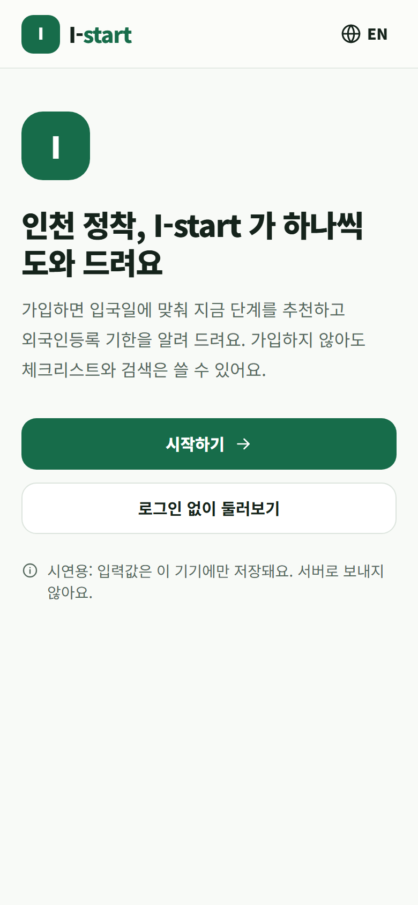
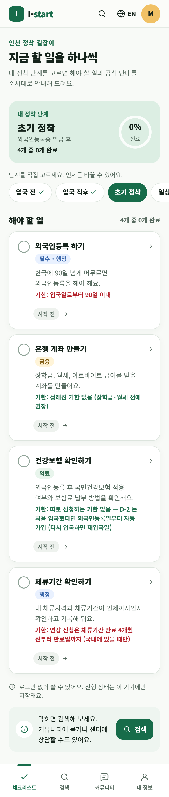
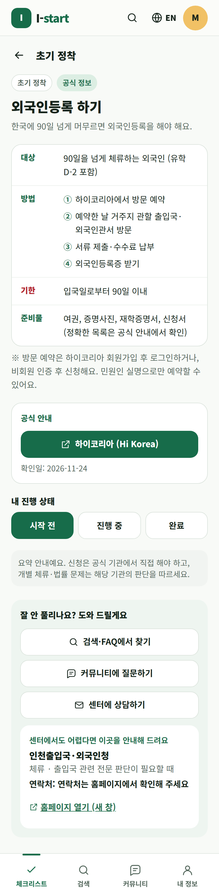
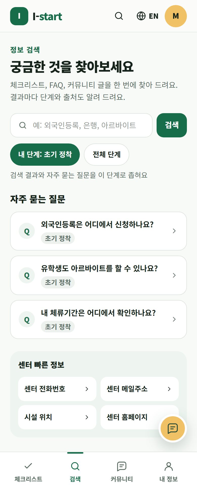
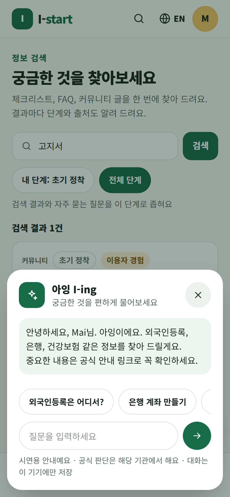
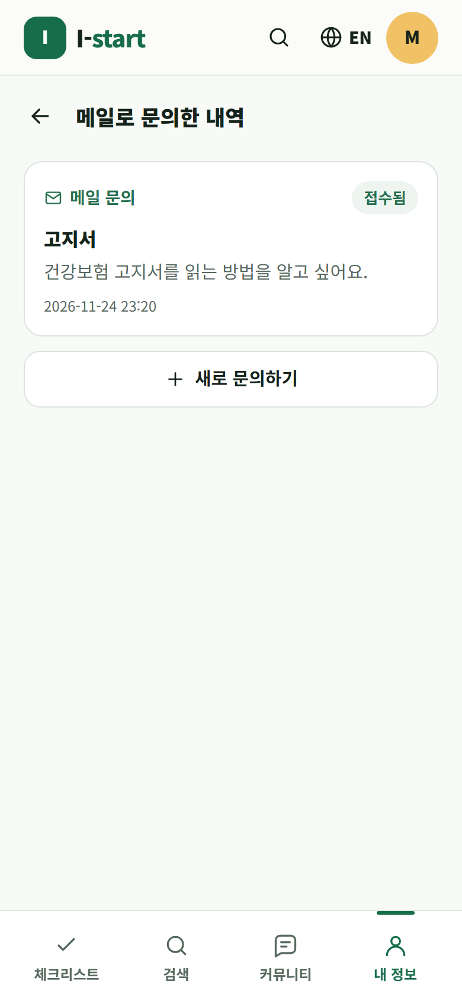
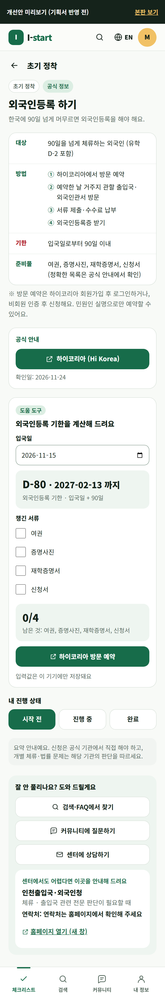
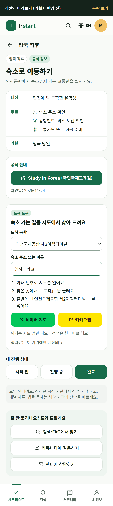

# I-start (아이스타트)

> 인천에 막 도착한 외국인 유학생이 정착 단계마다 해야 할 일을 하나씩, 공식 출처와 함께 끝내도록 돕는 모바일 웹 정보서비스 — 시연판

---

## :pushpin: 목차

- [프로젝트 소개](#book-프로젝트-소개)
- [바로 보기](#link-바로-보기)
- [주요 기능](#sparkles-주요-기능)
- [개선안 미리보기](#bulb-개선안-미리보기)
- [설계 근거](#triangular_ruler-설계-근거)
- [기술 스택](#hammer_and_wrench-기술-스택)
- [데이터 & 프라이버시](#lock-데이터--프라이버시)
- [한계](#warning-한계)
- [만든 사람](#bust_in_silhouette-만든-사람)

---

## :book: 프로젝트 소개

인천대학교 문헌정보학과 「정보서비스론」 팀 프로젝트 · 6조 · 2026-11

### 무엇을 풀려고 했나

> 「이 이용자는 무엇 때문에 필요한 정보를 이용하기 어려우며, 기관은 어떤 서비스로 그 문제를 줄일 수 있을까?」

- **이용자**: 인천에 거주하거나 거주할 예정인 초기 정착 외국인 유학생
- **정보 문제**: 공식 정보(Study in Korea · Hi Korea · 인천생활가이드북)는 있지만 흩어져 있고, 정착 단계에 따라 무엇을 먼저 할지 스스로 골라야 하며, 행정 용어 · 한국어 장벽이 있음
- **서비스**: 운영기관을 인천외국인종합지원센터로 **가정**한 모바일 웹 — 정착 단계별 체크리스트 · 검색(FAQ · 챗봇) · 커뮤니티

### 진행

- 2026-11-04 주제 · 사례조사 → 11-18 페르소나 · UI 시안 → 11-24 시연판 구현 · 배포 → 11-25 페르소나 시뮬레이션
- 이 저장소에는 **빌드 결과(시연판)** 만 있습니다. 기획서 · 보고서는 수업 제출물로 따로 관리합니다

---

## :link: 바로 보기

| 화면 | 주소 |
|---|---|
| 시연판 | https://baaaacode.github.io/istart-demo/ |
| 시연판 · 발표 모드 | https://baaaacode.github.io/istart-demo/?present=1 |
| 개선안 미리보기 | https://baaaacode.github.io/istart-demo/next/ |
| 자동 시연(앱이 스스로 진행) | https://baaaacode.github.io/istart-demo/?tour=1 · 개선안 `/next/?tour=1` · 영어 `&lang=en` |
| 예비 슬라이드(캡처 자동 넘김) | https://baaaacode.github.io/istart-demo/slides/main/ · `/slides/next/` |

- 첫 화면(「시작하기 / 로그인 없이 둘러보기」)은 그 브라우저에서 처음 열 때만 나옵니다. 다시 보려면 시크릿 창 또는 내 정보 → 「진행 상태 초기화」
- 발표 모드는 확인 전 값(「TODO」)을 「—」 로 가립니다. 끄려면 `?present=0`
- 한국어 · 영어 전환은 화면 오른쪽 위 언어 단추

---

## :sparkles: 주요 기능

<table>
<tr>
<td width="50%" valign="top">

**첫 방문 · 가입** : 언어 → 기본 정보 → 개인정보 동의 → 완료. 입국(예정)일로 **추천 단계**를 제안하고 확정은 이용자가 함. 외국인등록 기한을 「D-n」 으로 안내. 가입 없이 둘러보기도 가능

</td>
<td width="50%" valign="top">

**정착 단계 체크리스트** : 입국 전 · 입국 직후 · 초기 정착 · 일상생활 4단계, 20항목. 목록에서 바로 「시작 전 · 진행 중 · 완료」 표시. 입국일이 지나면 다음 단계로 옮길지 물어봄

</td>
</tr>
<tr>
<td width="50%" valign="top">

**항목 상세 + 공식 안내** : 대상 · 방법 · 기한 · 준비물로 나눠 짧게. 항목마다 그 정보가 있는 **공식 페이지로 바로 연결**(28건, 확인일 표시). 막히면 검색 · 커뮤니티 · 센터 상담 · 전문 기관으로

</td>
<td width="50%" valign="top">

**검색 · 자주 묻는 질문** : 체크리스트 · FAQ · 커뮤니티를 한 번에 검색. 결과마다 단계와 「공식 정보 / 이용자 경험」 출처 표시. 내 단계로 좁히기

</td>
</tr>
<tr>
<td width="50%" valign="top">

**챗봇 「아잉 I-ing」** : 서버 · AI 없이 앱 안 내용에서 답을 찾아 보여 줌(동의어 사전). 못 찾으면 커뮤니티 질문 · 센터 상담으로 넘김 — 지어낸 답이 나오지 않게

</td>
<td width="50%" valign="top">

**센터 상담 · 내 정보** : 메일 문의 · 전화상담 신청(시연용, 실제 발송 없음)이 내 정보의 문의 내역에 쌓임. 보유 기간 · 탈퇴 안내

</td>
</tr>
</table>

시연판을 헤드리스 Chrome 으로 촬영(390px, 2026-11-24). 이름 · 입국일 등은 전부 가상 데이터

---

## :bulb: 개선안 미리보기

시연판 위에 **항목별 도움 도구**를 얹은 다음 단계 제안입니다(`/next/`). 내 상황을 넣으면 다음 행동이 나옵니다.

<table>
<tr>
<td width="50%" valign="top">

**날짜 계산** : 입국일 → 외국인등록 기한(입국 후 90일) · 체류 만료일 → 연장 신청 가능 기간(만료 4개월 전 ~ 만료일)

</td>
<td width="50%" valign="top">

**지도 연결** : 숙소 주소 · 진료과 · 「편의점」 같은 검색어를 네이버 지도 · 카카오맵으로 넘김. 앱은 위치 정보를 받지 않음

</td>
</tr>
</table>

- 그 밖에 준비 서류 체크 · 상황별 도움 기관 · 가이드북 언어 선택 등 10종, 챗봇이 같은 도구를 대화창에 띄움

---

## :triangular_ruler: 설계 근거

| 정보 요구 | 근거 | 기능 | 기대하는 변화 |
|---|---|---|---|
| 정착 단계마다 필요한 정보가 다름 | 윤정원(2022) 정착단계별 정보추구행위 | 단계별 체크리스트 | 지금 할 일을 순서대로 앎 |
| 공식 정보를 찾고 이해하기 어려움 | 윤정원(2022) 검색 실험 · 최지영(2026) | 검색 · FAQ · 항목별 공식 페이지 연결 | 공식 출처로 확인하고 이해함 |
| 경험 공유 · 상호작용이 필요 | 최지영(2026) 비공식 정보원 의존 | 커뮤니티(공식 / 이용자 경험 구분) · 센터 상담 | 혼자 못 푼 문제를 다른 경로로 해결 |

- 공식 정보원: Study in Korea(국립국제교육원) · Hi Korea(법무부) · 외국인주민을 위한 인천생활가이드북 · 연계 기관(1345 외국인종합안내센터 · 대한법률구조공단 인천지부 · 인천출입국 · 외국인청 등)
- 공식 페이지 주소는 2026-11-24 에 하나씩 열어 확인함

---

## :hammer_and_wrench: 기술 스택

- **UI** : React 19 · TypeScript · Tailwind CSS 4 (팀 UI 시안을 Figma Make 로 만든 코드에서 출발)
- **Build** : Vite 8 → 정적 파일(상대 경로) · 한 파일판 HTML
- **Hosting** : GitHub Pages
- **Test** : 헤드리스 Chrome 으로 시나리오 자동 점검(한 · 영, 390 · 360px — 콘솔 오류 · 가로 넘침 · 44px 미만 단추 · 단추 안 줄바꿈)
- 서버 · 데이터베이스 · 외부 API 키 없음

---

## :lock: 데이터 & 프라이버시

- **서버가 없습니다.** 입력값(가입 정보 · 진행 상태 · 도구 입력)은 이 브라우저(localStorage)에만 저장됩니다
- 위치 정보를 받지 않습니다. 지도는 검색어만 지도 앱으로 넘깁니다
- 상담 · 문의 · 커뮤니티 글쓰기는 **시연용**으로 실제로 보내지지 않습니다
- 서비스 설계상의 개인정보 원칙(수집 항목 · 목적 · 보유 기간 · 탈퇴 시 파기)은 기획서에 따로 정리

---

## :warning: 한계

- **가상 서비스**입니다. 운영기관 · 인력 · 예산은 가정이며, 실제 기관과 협의한 것이 아닙니다
- 안내 내용은 요약이고, 신청 · 체류 · 법률 판단은 해당 기관을 따라야 합니다
- 공식 출처끼리 내용이 다른 항목(휴대폰 개통 서류 · 은행 서류 · 아르바이트 허용 시간)은 「공식 안내에서 확인」 으로 두었습니다
- 페르소나 시뮬레이션에서 찾은 문제(단계 정의와 항목 위치 · 건강보험 고지서 안내 없음 등)는 일부러 고치지 않고 보고서의 「발견한 문제」 로 남겼습니다

---

## :bust_in_silhouette: 만든 사람

정보서비스론 6조 팀 프로젝트

| 역할 | 담당 |
|---|---|
| 요구 분석 · 정보자원 · 구조 · 운영 · 홍보 | 6조 팀원 |
| 시연판 구현 · 배포 · 페르소나 시뮬레이션 · 발표 | [BaaaaCode](https://github.com/BaaaaCode) |
